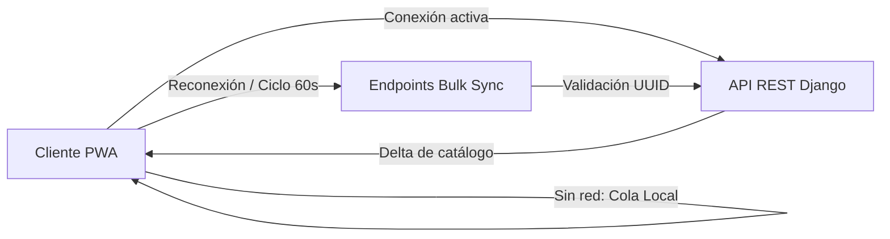

# AgroQuiriquina — Sistema de Gestión Agrícola y Operación Offline

Proyecto académico desarrollado para el diseño e implementación de una arquitectura cliente-servidor con soporte de operación desconectada (*Offline-First*) mediante Progressive Web App (PWA), control de acceso basado en roles (RBAC) y sincronización idempotente.

## 1. Objetivos y Alcance Académico

El sistema resuelve la problemática de registro operativo en zonas rurales con conectividad intermitente, aplicando los siguientes conceptos de ingeniería de software y seguridad informática:

* **Arquitectura Desacoplada:** Separación entre backend (API REST en Django) y frontend (SPA/PWA en React + TypeScript).
* **Tolerancia a Fallos de Red:** Cola de persistencia local en el cliente para operaciones críticas (ventas, clientes y registros de terreno) con sincronización diferida.
* **Integridad de Datos:** Uso de identificadores únicos universales (UUID) en el cliente para garantizar idempotencia y evitar duplicidad en reintentos de envío masivo (*bulk sync*).
* **Seguridad Aplicada:** Autenticación sin estado mediante JWT, derivación segura de contraseñas (PBKDF2-HMAC-SHA256), políticas de complejidad de claves y mitigación de ataques de fuerza bruta mediante bloqueo temporal de cuentas.

## 2. Stack Tecnológico y Arquitectura

| Capa | Tecnologías Implementadas |
|---|---|
| **Backend & API** | Python 3.10+, Django 5, Django REST Framework (DRF) |
| **Frontend & PWA** | React 18, TypeScript, Vite, Service Workers / LocalStorage |
| **Base de Datos** | SQLite 3 (entorno de desarrollo y pruebas) / PostgreSQL (contenedores) |
| **Infraestructura** | Docker y Docker Compose |
| **Documentación API** | OpenAPI 3.0 / Swagger UI (`/api/docs/`) |

### Diagrama de Sincronización



### Estructura del Proyecto

```text
apps/
  core/       Modelos base abstractos, validadores y clases de permisos
  users/      Gestión de identidad, roles (RBAC), clientes, proveedores y trabajadores
  inventory/  Control de stock, productos, insumos y trazabilidad de movimientos
  sales/      Lógica transaccional de ventas, abonos, despachos e indicadores financieros
  hr/         Registro de jornadas en terreno y cálculo de remuneraciones
  sync/       Procesamiento por lotes (bulk) y descarga incremental de catálogo
config/       Configuración modular de Django y enrutamiento principal
docker/       Scripts de inicialización y despliegue en contenedores
frontend/     Aplicación cliente React + TypeScript configurada como PWA

```

## 3. Modelo de Seguridad y Control de Acceso (RBAC)

La autorización se aplica a nivel de endpoints en el backend independientemente de las restricciones visuales del frontend:

| Módulo / Recurso | Administrador | Vendedor | Supervisor |
| --- | --- | --- | --- |
| Estado y Sincronización | Lectura / Escritura | Lectura / Escritura | Lectura / Escritura |
| Ventas y Despachos | Total | Solo registros propios | Sin acceso |
| Clientes | Total | Lectura / Creación | Sin acceso |
| Inventario y Bodega | Total | Solo lectura | Solo lectura |
| Terreno y Desempeño | Total | Sin acceso | Lectura / Escritura |
| Finanzas y Remuneraciones | Total | Sin acceso | Sin acceso |
| Administración de Usuarios | Total | Sin acceso | Sin acceso |

### Mecanismos de Autenticación Implementados

1. **Tokens JWT:** Emisión (`POST /api/v1/auth/token/`) y renovación (`POST /api/v1/auth/token/refresh/`).
2. **Política de Contraseñas:** Exigencia mínima de 8 caracteres combinando mayúsculas, minúsculas, números y símbolos.
3. **Bloqueo por Fuerza Bruta:** Tras 3 intentos fallidos consecutivos, la cuenta pasa a estado bloqueado (respondiendo código HTTP `423 Locked`), inhabilitando tanto nuevos inicios de sesión como la renovación de tokens existentes hasta la intervención manual de un administrador (`POST /api/v1/usuarios/{id}/desbloquear/`).

## 4. Guía de Instalación y Ejecución Local

### Prerrequisitos

* Python 3.10 o superior.
* Node.js 20.19+ y npm.

### Configuración del Backend

1. Crear y activar el entorno virtual desde la raíz del repositorio:

```powershell
python -m venv .venv
.\.venv\Scripts\Activate.ps1
```

2. Instalar dependencias, ejecutar migraciones y poblar la base de datos con el escenario de evaluación:

```powershell
pip install -r requirements.txt
python manage.py migrate
python manage.py seed_demo
```

3. Levantar el servidor de desarrollo:

```powershell
python manage.py runserver
```

### Configuración del Frontend

En una segunda terminal:

```powershell
cd frontend
npm ci
npm run dev
```

*(Opcional)* **Despliegue mediante Docker Compose:**

```powershell
cp .env.docker.example .env
docker compose up --build
docker compose exec web python manage.py seed_demo
```

## 5. Escenario de Pruebas y Cuentas de Evaluación

El comando `seed_demo` genera un entorno controlado con datos transaccionales, un producto con quiebre de stock para validar alertas de revisión y usuarios preconfigurados con la contraseña `Cambiar123!`:

| Usuario | Rol Asignado | Caso de Prueba Sugerido |
| --- | --- | --- |
| `admin` | Administrador | Auditoría global, finanzas, nómina y desbloqueo de cuentas |
| `vendedor1` | Vendedor | Registro de ventas offline/online y visualización filtrada |
| `vendedor2` | Vendedor | Verificación de aislamiento de datos (no ve registros de `vendedor1`) |
| `supervisor1` | Supervisor | Carga por lotes de desempeños en terreno y consulta de insumos |

## 6. Pruebas Automatizadas y Verificación

Para validar la integridad del backend y el tipado estático del frontend:

```powershell
# Pruebas unitarias y de integración en Django
python manage.py test

# Verificación de tipos y compilación en TypeScript/React
cd frontend
npm run type-check
npm run build
```

## 7. Limitaciones Conocidas (Alcance del Prototipo)

* **Persistencia Local:** La cola offline utiliza `localStorage` sin cifrado en reposo en el navegador; en un entorno productivo se recomienda migrar a IndexedDB con cifrado a nivel de aplicación.
* **Resolución de Conflictos:** La sincronización previene duplicados mediante UUID, pero no implementa resolución automática de conflictos (*CRDTs* o *Last-Write-Wins* granular) ante ediciones concurrentes sobre un mismo registro maestro.
* **Certificados SSL:** La instalación completa como PWA en dispositivos móviles externos requiere servir la aplicación bajo HTTPS.
````[cite: 2]